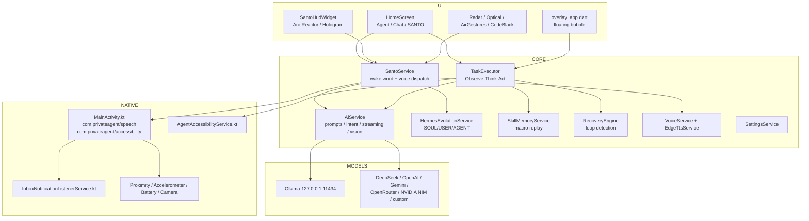

# S.A.N.T.O. — Technical Guide

> **S.A.N.T.O.** = *Smart Autonomous Neural Task Operator* — pronounced **"SANTO"**.
> Flutter 3.47.x / Dart 3.13.x · Android 8.0+ (minSdk 26) · version 2.0.0+3

This guide documents how the app is put together, how the agent loop works, where state
lives, and how to extend or debug it. For end-user instructions see
[USER_GUIDE.md](USER_GUIDE.md).

---

## 1. Stack and toolchain

| Item | Value |
|---|---|
| Framework | Flutter (stable), Material 3 |
| Dart SDK constraint | `^3.12.2` |
| Flutter SDK floor | `>=3.44.0` (verified on 3.47.9 / Dart 3.13.7) |
| Android namespace / application ID | `com.privateagent.private_agent` |
| minSdk / targetSdk / compileSdk | 26 / 36 / 36 |
| Java / Kotlin | JVM 17 |
| Static analysis | `flutter_lints` 6.x, `flutter analyze` → **0 issues** |
| Tests | `flutter test` → **65 passing** |

Core dependencies: `http`, `speech_to_text`, `flutter_tts`, `shared_preferences`,
`path_provider`, `permission_handler`, `flutter_local_notifications`,
`flutter_overlay_window`, `installed_apps`, `flutter_contacts`, `share_plus`,
`flutter_markdown_plus`, `shizuku_api`, `volume_controller`, `screen_brightness`, `intl`,
`uuid`, `crypto`.

### Dependency policy

`flutter pub upgrade` keeps every package on the newest version allowed by
`pubspec.yaml`; the lockfile is committed. Three majors are intentionally held
back because they would break the current Android toolchain or need device
regression testing:

| Package | Held at | Why |
|---|---|---|
| `permission_handler` | 12.x | 13.x requires `compileSdk 37`; the project targets Flutter's SDK 36 |
| `flutter_local_notifications` | 22.x | 23.x also requires `compileSdk 37` |
| `flutter_overlay_window` | 0.5.x | 1.x rewrites the native overlay service (new notification/dismiss APIs); upgrade after HUD testing on a device |

Everything else is current as of the 2.0.0 dependency refresh (40 packages
updated). Do not run `flutter pub upgrade --major-versions` casually: it will
attempt those three jumps.

---

## 2. Boot sequence

`lib/main.dart` runs before the first frame:

1. `NativeBridgeService.init()` — registers the platform channel clients.
2. `SettingsService.init()` — loads prefs, runs the JARVIS→SANTO migration, enables the
   system prompt by default.
3. `TaskExecutor.init()` — wires automation, AI and skill memory singletons.
4. `HermesEvolutionService.init()` — loads `SOUL.md`, `USER.md`, `AGENT.md`.
5. `CalendarReminderService` / `TodoService` init.
6. If `santoAlwaysOn` is true, `SantoService.ensureAlwaysOnRunning()` starts the wake-word
   listener.
7. Telegram long-poll wiring and overlay command wiring.
8. `runApp(PrivateAgentApp())`.

`PrivateAgentApp` (`lib/app.dart`) supplies the `navigatorKey`, light/dark themes,
`themeMode` from settings, and routes to `OnboardingScreen` until
`onboarding_complete` is true, then `HomeScreen`. It also listens for the charging HUD
signal and shows `ArcReactorChargingDialog`.

`HomeScreen` hosts the three modes (`AppMode.agent`, `AppMode.chat`, `AppMode.santo`),
the mode switcher, input dock, transcript, HUD, active-task bar and drawers.

---

## 3. Architecture



### Service catalog

**Orchestration / AI**
- `santo_service.dart` — central controller: wake-word extraction, continuous listening,
  command dispatch, spoken replies, proactive prompts, sentry/charging hooks.
- `ai_service.dart` — provider HTTP client, system/chat prompts, intent fallback router,
  SSE chat streaming, one-shot completion, multimodal vision, `AiException`.
- `task_executor.dart` — agent loop, transcript, chat history, pause/cancel, finalization,
  notifications, overlay broadcast.
- `personality_service.dart` — archetype/formality/humour, emotion detection, persona
  prompt, persisted `personality_archetype`.
- `hermes_evolution_service.dart` — tri-partite markdown context and evolution log.
- `conversational_memory_service.dart` — remembered facts injected into prompts.
- `recovery_engine.dart` — repeated-action / stuck-screen detection.
- `skill_memory_service.dart` — successful action sequences keyed by normalised goal.

**Device / automation**
- `screen_automation_service.dart` — accessibility channel: dump, click, type, scroll,
  swipe, back/home, node formatting and compression.
- `app_launcher_service.dart`, `system_control_service.dart`, `phone_storage_service.dart`.
- `macro_recorder_service.dart`, `workflow_service.dart`, `routine_automation_service.dart`.
- `sentry_service.dart`, `security_alert_service.dart`, `code_black_service.dart`.
- `air_gesture_service.dart`, `charging_telemetry_service.dart`, `sound_radar_service.dart`,
  `vision_perception_service.dart`.

**Productivity / knowledge**
- `calendar_reminder_service.dart`, `todo_service.dart`, `notes_knowledge_service.dart`,
  `email_triage_service.dart`, `inbox_service.dart`, `message_drafting_service.dart`,
  `form_filling_service.dart`, `finance_tracking_service.dart`, `sports_service.dart`,
  `commute_traffic_service.dart`, `smart_home_service.dart`.

**Fun / specialty**
- `airspace_radar_service.dart`, `network_audit_service.dart`,
  `optical_solver_service.dart`, `polyglot_diplomat_service.dart`,
  `multi_task_service.dart`, `floating_copilot_service.dart`,
  `system_diagnostics_service.dart`, `app_usage_service.dart`.

**Audio**
- `voice_service.dart` — STT/TTS facade, `sanitizeForSpeech`, local voice profiles.
- `edge_tts_service.dart` — Edge neural TTS, disk cache, fallback.

**Infrastructure**
- `settings_service.dart`, `permission_manager_service.dart`, `native_bridge_service.dart`,
  `telegram_service.dart`.

---

## 4. The agent loop (Agent mode)

`TaskExecutor.executeTask(goal)`:

1. Reject if already running. Reset state, step counter, log, recovery engine.
2. **Accessibility gate** — `ScreenAutomationService.isServiceEnabled()`. If off, log an
   actionable error and fail.
3. **Skill fast path** — if skills are enabled, `SkillMemoryService.findMatch(goal)` at
   ≥ 0.75 similarity. Replay the stored steps; mark the skill success/failure and fall
   back to the model on failure.
4. **AI loop** (`maxSteps` from settings, default 15):
   - **Observe** — `dumpScreen()` returns `ScreenNode`s; the full dump is recorded for
     recovery, and a goal-compressed description is produced.
   - **Think** — `AiService.complete(goal, screenDescription)` returns raw model text.
   - **Parse** — `TaskStep.tryParse` tolerates markdown fences, prose, balanced-brace
     extraction, and natural-language fallbacks; `TaskStep.fromJson` normalises aliases
     (`tap`→`click_text`, `launch`→`open_app`, `finish`→`done`, …).
   - **Act** — `_performAction` dispatches through `ScreenAutomationService`.
   - **Recover** — `RecoveryEngine.shouldRecover` triggers `suggestRecovery()`.
   - **Delay** — `Future.delayed(stepDelayMs)` then broadcast overlay state.
5. **Finalize** — `_finalize(goal, status, telegramChatId)` stores history, learns a skill
   on success when no skill was replayed, posts a completion notification, speaks a
   summary, and reports to Telegram when requested.

### Action wire format

```json
{"action": "<action>", "params": { }, "reasoning": "<max 25 words>", "is_complete": false}
```

| Action | Params |
|---|---|
| `click_text` | `text` |
| `click_at` | `x`, `y` |
| `type_text` | `text` |
| `press_enter` | — |
| `scroll` | `direction`: down/up/left/right |
| `swipe` | `startX`, `startY`, `endX`, `endY`, `durationMs?` |
| `press_back` | — |
| `press_home` | — |
| `open_app` | `app` (name or package) |
| `wait` | `ms` (max 10000) |
| `done` | — (also sets `is_complete: true`) |

Supported set lives in `TaskStep.supportedActions`; anything else is rejected by the
parser. The system prompt (`AiService.buildSystemPrompt`) also encodes safety rules:
never invent UI elements, prefer `click_text`, open the right app first, do not repeat a
no-op action, and never make purchases/deletions/account actions unless the goal says so.

### Skills

`SkillMemoryService` stores at most 100 skills in `skill_memory_v1` (JSON list), with
`successCount`, `lastUsedAt`, and normalised goal text. A successful non-replayed task is
saved as a new skill; replay failures decrement/remove it.

### Recovery

`RecoveryEngine` records screen hashes and action signatures; a repeated signature or
unchanged screen yields a recovery step (scroll, back, coordinate fallback) instead of
looping forever.

---

## 5. Chat pipeline

`TaskExecutor.sendChatMessage(text)`:

1. Ignore empty input; if an agent task is running or another chat reply is streaming,
   log an explanatory error instead of silently dropping the message.
2. Append a user bubble and an empty agent bubble, then stream
   `AiService.chatStream(message, history)`. Tokens update the bubble live.
3. If the stream yields nothing, fall back to `AiService.chat(...)`.
4. Keep the last `_maxChatTurns = 20` turns (40 messages), trimming oldest pairs.
5. Errors remove the empty agent bubble and append a red error bubble; `finally` clears
   the busy flag and broadcasts the overlay.

`buildChatSystemPrompt` combines Hermes context, the persona prompt, conversational memory
and chat-specific tone rules. It explicitly states that Chat mode cannot tap the screen.

---

## 6. SANTO voice pipeline and wake word

### Wake-word normalisation (`SantoService.extractWakeCommand`)

1. Normalise `S.A.N.T.O.` spellings (`s . a . n . t . o`) to `santo`.
2. Fold phonetic STT variants: `sainto`, `santu`, `santoo`, `san to`.
3. Strip punctuation and collapse whitespace.
4. Match one pattern:
   - greeting + wake word: `hey|hello|hi|okay|ok|yo|listen|wake up|dear|are you there|you there` + `santo|google`
   - `santo` + `wake up|please|online|are you there`
   - standalone `santo`
   - greeting + `google`
5. Return `''` when only the wake phrase/greeting was spoken, the trailing command when
   the wake word came first, the leading command when it came last, or `null` when no
   wake word matched (ambient conversation rejection).

Native Kotlin (`MainActivity.containsWakeWord`) independently accepts `santo`, `santu`,
`sainto`, `san to`, `saint o`, `s.a.n.t.o` to decide whether a recognition result is a
candidate wake event. The Dart layer performs the final command extraction.

### Audio path

- Speech recognition runs through `com.privateagent/speech` and Google's
  `SpeechRecognizer` (not the OEM on-device recogniser, which is buggy on several devices).
- `VoiceService` exposes `startListening`, `stopListening`, continuous mode, TTS init,
  `speak`, and `sanitizeForSpeech` (turns `S.A.N.T.O.`/`SANTO` into spoken `Santo`).
- `EdgeTtsService` synthesises neural audio, caches by hash under the temp/cache
  directory, and falls back to `flutter_tts` if the network or cache is unavailable.

---

## 7. AI service internals

### Provider resolution

`SettingsService` stores `ai_provider`, `ai_base_url`, `ai_api_key`, `ai_model`,
`ai_max_tokens` (128–16384, default 2048), `ai_temperature` (0–2, default 0.2),
`ai_use_system_prompt`.

`AiService`:

- Sends `Authorization: Bearer <key>` **only when a key is present**, so local servers
  that reject empty auth still work.
- Adds OpenRouter `HTTP-Referer: https://santo.app` and `X-Title: S.A.N.T.O.`.
- Treats `ollama`, `localFirstPrivacyMode`, or a localhost base URL as a local backend.
- `chatStream` uses SSE (`stream: true`) and yields content deltas; `complete` performs
  one non-streaming JSON action request; `vision` posts an image data URL in OpenAI
  multimodal format.

### Intent routing

`SantoIntent` / `SantoIntentType` provides a deterministic offline fallback when the
model is not needed or unavailable. It recognises device commands and specialty features
(torch, battery, weather, news, workflows, todos, calendar, email, translation, air
gestures, charging telemetry, Code Black, floating co-pilot, airspace, network audit,
optical solver, multi-task dumps, app actions). The cloud intent classifier is asked to
return one of the same type names; unknown output degrades to `chat` or `action`.

### Prompts

- Agent: strict single-JSON-action contract, screen dump syntax
  `#<index> "<label>" [<class>] @(x,y) <flags>`, safety rules, completion contract.
- Chat: S.A.N.T.O. identity ("pronounced SANTO", built by Abuzar), anti-cliché tone
  guidance, adaptive tone shifts, Markdown allowed, no device actions.
- Persona: archetype/formality/humour + emotion detection injected by
  `PersonalityService`.
- Hermes: `SOUL.md` (identity/guardrails), `USER.md` (operator profile/facts),
  `AGENT.md` (protocols/skills) are concatenated into the prompt.

---

## 8. Native Android layer

Package: `com.privateagent.private_agent` (`android/app/src/main/kotlin/...`).

- **`MainActivity.kt`**
  - Method channels: `com.privateagent/speech`, `com.privateagent/accessibility`.
  - Speech recognition lifecycle, continuous listening, media-playback suppression,
    wake-word pre-filtering.
  - Proximity/accelerometer listeners, battery/power broadcasts, camera capture
    (`santo_eye_*.jpg`), file provider helpers.
  - Shizuku provider declared in the manifest.
- **`AgentAccessibilityService.kt`** — exposes the node tree and dispatch commands
  (click by text/coords, set text, scroll, swipe, global back/home, app launch).
- **`InboxNotificationListenerService.kt`** — captures SMS/email notifications for triage.
- **`overlay_app.dart`** renders the floating bubble in a separate Flutter engine.

Manifest highlights: `INTERNET`, `RECORD_AUDIO`, `SYSTEM_ALERT_WINDOW`,
`FOREGROUND_SERVICE` (+ microphone/special-use), `POST_NOTIFICATIONS`, `CAMERA`,
`READ/WRITE_CONTACTS`, `READ/SEND SMS`, `QUERY_ALL_PACKAGES`, storage and usage access,
`WRITE_SETTINGS`, `SET_ALARM`. Services: accessibility (`S.A.N.T.O. Screen Control`),
overlay, notification listener. App label: **S.A.N.T.O.**

---

## 9. Persistence

All state is `SharedPreferences` unless noted.

| Key | Contents |
|---|---|
| `ai_provider`, `ai_base_url`, `ai_api_key`, `ai_model` | Model configuration |
| `ai_max_tokens`, `ai_temperature`, `ai_use_system_prompt` | Generation controls |
| `agent_max_steps`, `agent_step_delay_ms`, `agent_skills_enabled` | Agent behaviour |
| `ui_app_mode` | `agent` \| `chat` \| `santo` |
| `santo_screen_style` | `arcReactor` \| `santo` |
| `santo_always_on`, `santo_voice`, `santo_neural_voice`, `santo_use_neural_voice` | Voice/HUD |
| `santo_workflows_enabled`, `santo_eye_enabled`, `santo_auto_speak_enabled` | Feature toggles |
| `local_first_privacy_mode`, `confirm_risky_actions` | Safety/privacy |
| `santo_workflows_v1`, `santo_todos_v1`, `santo_notes_knowledge_v1` | JSON feature stores |
| `skill_memory_v1` | Learned action sequences |
| `hermes_soul_md_v1`, `hermes_user_md_v1`, `hermes_agent_md_v1` | Markdown context |
| `hermes_last_evolved_v1`, `hermes_evolution_log_v1` | Evolution metadata |
| `personality_archetype`, `personality_formality`, `personality_humor` | Persona |
| `telegram_enabled`, `telegram_token`, `telegram_owner_chat`, `telegram_offset` | Remote control |
| `smart_home_ha_url`, `smart_home_ha_token`, `smart_home_default_entity` | Home Assistant |
| `commute_home_address`, `commute_work_address`, `commute_mode` | Commute |
| `onboarding_complete`, `ui_theme_mode`, `voice_feedback` | UI state |

`HermesEvolutionService` also mirrors the three markdown files into the app documents
directory (`.../hermes/soul.md`, `user.md`, `agent.md`).

### JARVIS → SANTO migration

`SettingsService._migrateLegacySettings()` runs on every startup (idempotent):

- Copies every `jarvis_*` key to `santo_*` if the new key does not exist, preserving
  types (bool/int/double/String/List<String>), then removes the legacy key.
- Rewrites persisted enum values `ui_app_mode=jarvis` → `santo`,
  `personality_archetype=jarvis` → `santo`, `santo_screen_style=jarvis` → `santo`.

Because the migration is prefix-based it also carries over the old workflow/todo/notes
stores, which were renamed with the same prefix.

---

## 10. Model catalog

Presets live in `SettingsService.providers` and are curated to working late-2026
chat models with OpenAI-style tool calling:

| Provider key | Label | Base URL | Default model |
|---|---|---|---|
| `deepseek` | DeepSeek | `https://api.deepseek.com/v1` | `deepseek-flash` |
| `openai` | OpenAI | `https://api.openai.com/v1` | `gpt-6.1-sol` |
| `gemini` | Google Gemini | `https://generativelanguage.googleapis.com/v1beta/openai` | `gemini-3.8-flash` |
| `openrouter` | OpenRouter | `https://openrouter.ai/api/v1` | `openai/gpt-6.1-sol` |
| `nvidia` | NVIDIA NIM | `https://integrate.api.nvidia.com/v1` | `nvidia/nemotron-3-super-120b-a12b` |
| `ollama` | Ollama (local) | `http://127.0.0.1:11434/v1` | `qwen3.5:4b` |

The model field is intentionally free text so users can switch IDs without an app update.
`SettingsService.model` falls back to `deepseek-flash` when unset.

---

## 11. Testing and quality gates

```bash
flutter pub get
flutter analyze      # target: No issues found!
flutter test         # target: All tests passed!
```

Current status on Flutter 3.47.9 / Dart 3.13.7 after the 2.0.0 dependency
refresh: **analyze clean, 65 tests passing**.

Test suites:

- `test/widget_test.dart` — onboarding boot, mode persistence, provider/model field
  behaviour, workflow matching, settings persistence, voice sanitisation.
- `test/santo_features_test.dart` — 828 lines covering memory, personality, calendar,
  email triage, todos, notes, routines, finance, sports, proactive prompts, wake-word
  gating, Hermes, macro recorder, smart home, commute, intent routing, superpowers,
  form filling, workflow equivalence, polyglot, Code Black, multi-task decoupling,
  optical solver and settings.

Tests run headless; plugin calls that are unavailable in the test VM
(`MissingPluginException`) are tolerated/logged by the services under test.

### Build

```bash
flutter build apk --release   # build/app/outputs/flutter-apk/app-release.apk
adb install -r build/app/outputs/flutter-apk/app-release.apk
```

Android SDK 36 and JDK 17+ are required (JDK 21 is verified). The release build
currently signs with the debug key; provide a real keystore before distributing.

On Windows, Flutter rejects an Android SDK that lives under a path containing
spaces (for example `C:\Program Files (x86)\Android\android-sdk`). Create a
junction without spaces and point `ANDROID_HOME` at it:

```powershell
cmd /c mklink /J C:\AndroidSdk "C:\Program Files (x86)\Android\android-sdk"
$env:ANDROID_HOME = "C:\AndroidSdk"
$env:JAVA_HOME = "C:\Program Files\Android\openjdk\jdk-21.0.8"
```

---

## 12. Extension recipes

**Add a provider preset**
1. Add an entry to `SettingsService.providers` (label, baseUrl, model).
2. It appears automatically in the settings chip list; no UI change needed.

**Add an agent action**
1. Add a constant + `supportedActions` entry in `TaskStep` and normalise aliases in
   `fromJson`.
2. Handle it in `TaskExecutor._performAction`.
3. Implement the platform call in `ScreenAutomationService` and
   `AgentAccessibilityService.kt`.
4. Document it in `AiService.buildSystemPrompt` and this guide.

**Add a voice intent**
1. Add a `SantoIntentType`.
2. Add fallback recognition in `SantoIntent.fallback`.
3. Handle it in `SantoService` dispatch and add any service call.
4. Add the type name to the intent-classifier prompt so cloud routing can return it.

**Add a persistent feature store**
Use a versioned `santo_<feature>_v1` string key holding JSON, mirroring
`TodoService`/`NotesKnowledgeService`, and initialise it in `main.dart`.

**Change the wake word**
Update both `SantoService.extractWakeCommand` (normalisation + pattern) and
`MainActivity.containsWakeWord` (native pre-filter); they must agree.

---

## 13. Security and limitations

- API keys and personal data are stored unencrypted in app-private `SharedPreferences`.
  Use Android user profiles / device encryption for strong isolation.
- Accessibility automation cannot see `FLAG_SECURE` windows (banking, password managers).
- Screen coordinates are device- and orientation-dependent; portrait is recommended.
- Small local models may emit invalid JSON; the parser is forgiving but a tool-calling
  cloud model is more reliable for long tasks.
- Edge TTS requires network access the first time a phrase is spoken; cached phrases work
  offline and `flutter_tts` is the fallback.
- The release build must be re-signed with a private keystore before publishing.
- `QUERY_ALL_PACKAGES`, accessibility, SMS and all-files access are powerful; Play Store
  distribution requires policy declarations and justification.
